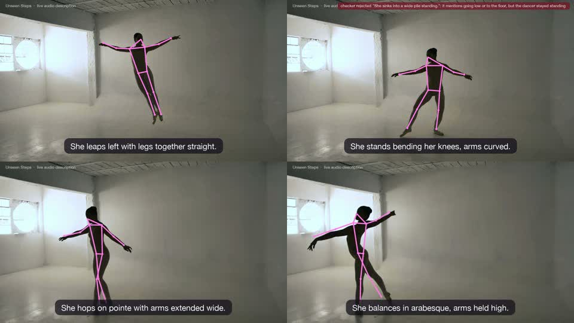
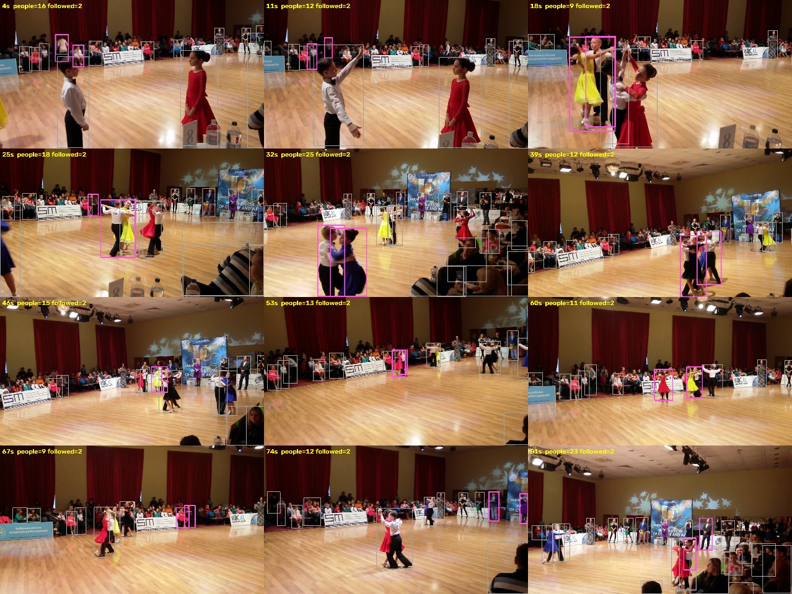
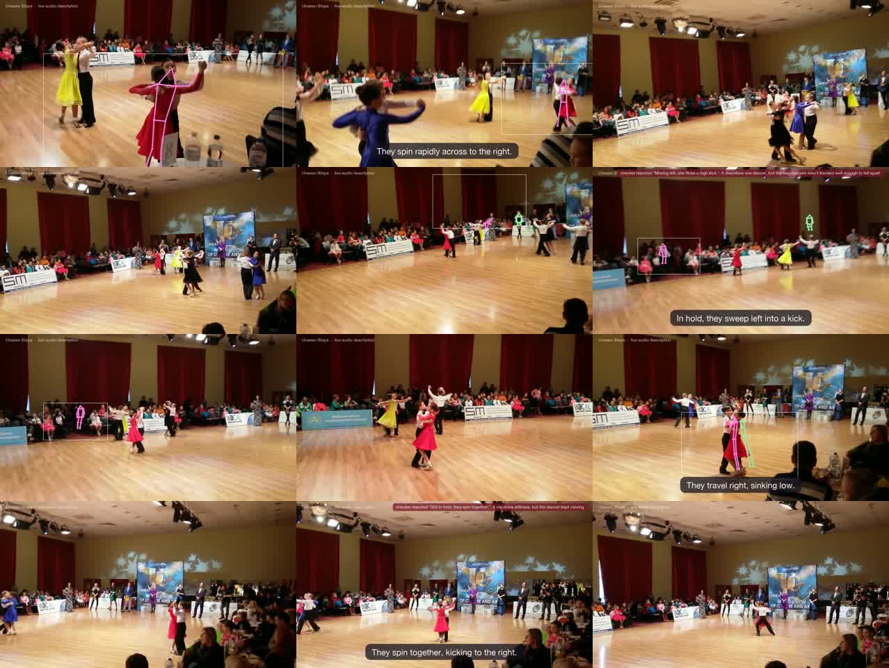

# Welcome to Unseen Steps

**Live audio description of dance for blind and partially sighted audiences.** A camera watches the
dancers, computer vision measures the movement, Gemini turns it into short spoken lines, and each line is
spoken through earphones in the gaps between musical phrases, so it never talks over the music. Every line is
checked against the measured movement before anyone hears it.

Built at Encode London (23–25 Oct 2026) by **Anusha** (music, narration, Gemini pipeline), **Andrii**
(ballroom dancer: pose on his laptop, dance glossary, MongoDB) and **Nastia** (computer vision, with Anusha).

**Deadlines:** checkpoint 2 **Sat 18:00** · rehearsal in the demo spot **Sat 20:00** · final submission
**Sun 25 Oct 12:00**.

## Watch this first

[`docs/media/ballet-demo.mp4`](media/ballet-demo.mp4) (23 s, sound on). The pink skeleton is the pose
tracking; captions are the spoken lines; the red badge is the checker rejecting a line ("She sinks into a
wide plié") because the dancer stayed standing, then the rewrite that passed.



## Why it matters

Human audio description for dance exists, but usually for one or two performances per run, and small venues,
school and studio shows get none. The idea came from Anusha's robotics tutor, Gerard Canal, who dances
ballroom with blind dancers. Next step after the weekend: the same tracking as a training tool for blind
dancers.

## How it works

```
Before the show:  song ──► music.py: beats, phrases, "clean spaces" to speak in
                  Argon watches the whole performance ──► performance map (style, sections, motifs)
                  Deep Research ──► dance glossary in MongoDB (vetted by Andrii)

Live, per phrase (~16 beats, every 6–8 s):
  camera ──► YOLO pose ──► follow the chosen dancers ──► features for the phrase
         ──► writer (Gemini 3.8 Flash, ≤ 8 words) ──► checker (words must match the measurements)
         ──► voice (Gemini TTS) ──► spoken in the next clean space
```

Each Gemini model has one job: **Argon** directs (whole-performance understanding), **Robotics-ER** picks who
to follow ("the girl in the red dress"), **Flash** writes lines, **TTS / Live** speaks, **Deep Research**
builds the glossary. Details and reasoning: [`CLAUDE.md`](../CLAUDE.md).

## Progress so far

| Piece | File | State |
| --- | --- | --- |
| Music map | `server/music.py` | Works |
| Line writer | `server/writer.py` | Works, ~2–3 s per line |
| Checker | `server/checker.py` | Works |
| Write → check → rewrite loop | `server/narrate.py` | Works |
| Voice | `server/speech.py` | Works |
| Translation (uk, de) | `server/localise.py` | Works |
| Glossary (Deep Research → MongoDB) | `server/glossary_research.py` | 17 waltz draft terms in Atlas with embeddings; vector index ready; awaiting Andrii's vetting |
| Kill test + demo renderer | `scripts/killtest.py` | Works end to end on a clip |
| Argon director, Robotics-ER targeting | – | Both tested by hand and working; code today |
| Live demo program | `scripts/live.py` | To build today (the headline) |
| **Computer vision quality** | `scripts/killtest.py` | **Good on a solo dancer with a fixed camera; unreliable on crowded, handheld competition footage. This is where you come in.** |

## Computer vision: where it stands

**Model:** `yolo11n-pose` (Ultralytics, 17 COCO keypoints, ~7–15 fps on a MacBook GPU). MediaPipe was tried
first and found 0–1 dancers per frame on competition footage, so it was dropped.

**Following the right dancers** (in `scripts/killtest.py`):
1. *By position* (`follow`): nearest detections to where the couple was. Jumped between couples and onto
   spectators.
2. *By clothing colour* (`appearance`, HSV histograms) plus a "moving relative to the crowd" filter to ignore
   spectators. Better, still confused by similar dresses.
3. *Current, when told who to follow* (`track_focus`): CamShift on her dress colour near where it was last
   seen, a smoothly moving focus frame around the couple, pose run only inside that frame (enlarged),
   skeletons smoothed with capped per-frame jumps, silence when she's out of shot, re-acquire only when pose
   confirms a standing person in matching clothes. Precise, but drops a lot of coverage on handheld footage.




**Features per phrase** (`phrase_features`): speed, travel left/right, hip rise (jumps), lowest level (floor
work), turns (left/right shoulders swapping order, debounced), arms above head, kicks (ankle above knee),
stillness, partner separation (hip distance, with hysteresis). All thresholds were tuned by eye on two clips,
and some are fragile: turn counting is noisy at low resolution, raised arms and "low" are meaningless in a
ballroom hold, long dresses hide ankles, handheld camera pans distort "travel".

## Where you could help most (proposed; agree with Anusha)

1. **An evaluation set before more tuning.** Label 2–3 short clips by hand (when each turn, jump, hold,
   separation happens), then measure precision/recall of our event detection. Right now every change is
   judged by watching a video.
2. **Proper temporal filtering** of keypoints (e.g. One Euro or Savitzky–Golay, weighted by keypoint
   confidence, with interpolation through short occlusions) instead of the current simple blending.
3. **Gait-analysis-style features:** joint angles (knee, hip, elbow), torso lean, body rotation from
   shoulder/hip vectors and shoulder-width foreshortening, which should make turn counting far more robust.
4. **Pose "signatures" for dance terms**, with Andrii: a rule per glossary term (e.g. arabesque: standing leg
   straight, other leg extended behind near hip height) so a term is only spoken when the body shape matches.
5. **Model benchmark for the live demo:** `yolo11n/m/l-pose` (and others if useful) on our clips and on
   Andrii's laptop, accuracy against speed. Live needs ≥ 10 fps.
6. **Couples in hold:** bodies that merge into one detection or swap identities.

The live demo is one dancer (Andrii) in front of a fixed camera, which is the easy case, so items 1–3 and 5
matter most today.

## Getting set up

1. Accept the GitHub invite to `anushaisawesome/unseen-steps` (send Anusha your GitHub username).
2. `python3.12 -m venv .venv && .venv/bin/pip install -r requirements.txt` (ffmpeg needed too).
3. `cp .env.example .env`, then add your own Gemini key (aistudio.google.com/apikey). For the database,
   create your own Atlas database user and add your IP (steps in `CLAUDE.md`, "Database").
4. `scripts/get_demo_clip.sh`, then `python scripts/killtest.py clips/ballet.mp4 --bars-per-phrase 2`.
   Output: `data/killtest/ballet-annotated.mp4`.
5. For crowded footage: `python scripts/track_debug.py <clip> sheet.jpg --seed t,x,y` draws who's being
   followed (pink) against everyone detected (grey).

## Read next

- [`CLAUDE.md`](../CLAUDE.md): current state, every decision and why, task lists. Kept up to date.
- [`SPEC.md`](../SPEC.md): Andrii's original specification (parts are out of date; `CLAUDE.md` wins).
- [`docs/demo-video.md`](demo-video.md): the submission video plan.

Privacy: video frames are never stored, only pose points; uploads are deleted after processing.
